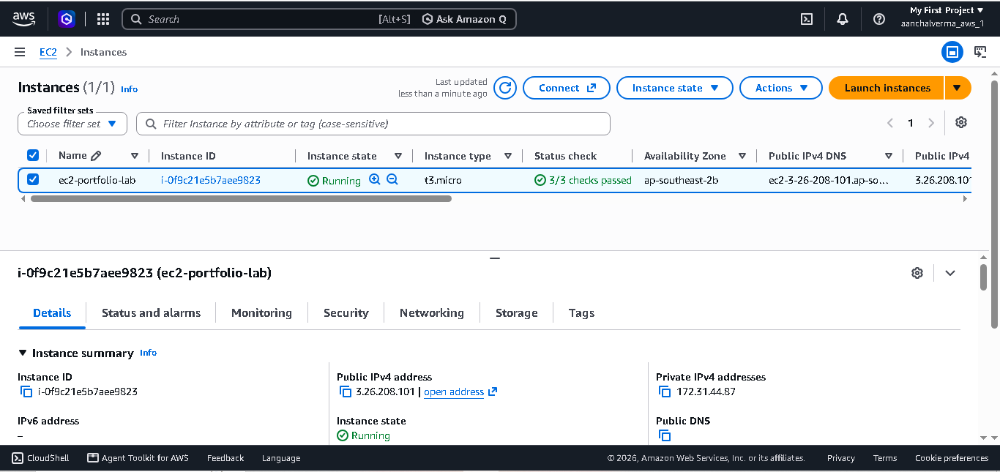
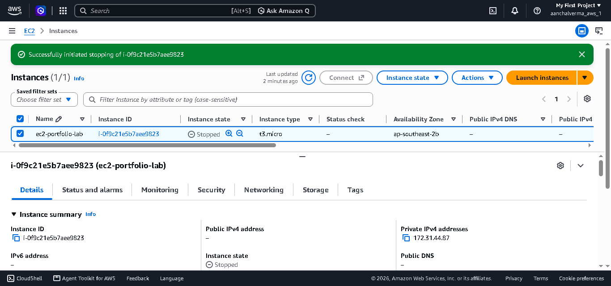
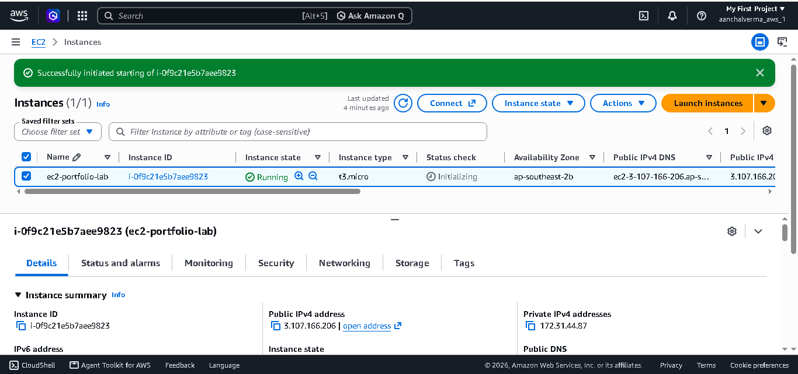
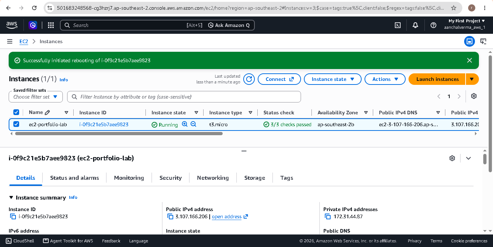

# Lab 04: Explore EC2 Instance States

## Objective

The objective of this lab is to understand different Amazon EC2 instance states and learn how to start, stop, and reboot an EC2 instance using the AWS Management Console.

## AWS Services Used

- Amazon EC2
- Amazon EBS (for persistent block storage)

## What Are EC2 Instance States?

EC2 instance states represent the current lifecycle status of an instance.

| State | Description |
|---|---|
| Pending | The instance is preparing to start. |
| Running | The instance is running and ready to use. |
| Stopping | The instance is preparing to stop. |
| Stopped | The instance is shut down but can be started again. |
| Rebooting | The instance is restarting. |
| Shutting-down | The instance is preparing for termination. |
| Terminated | The instance has been permanently terminated. |

## Practical Steps

### 1. Check the Running State

1. Open the AWS Management Console.
2. Navigate to EC2 → Instances.
3. Select the required EC2 instance.
4. Verify that the instance state is `Running`.

### 2. Stop the Instance

1. Select the EC2 instance.
2. Choose Instance state → Stop instance.
3. Confirm the action.
4. Wait until the state changes to `Stopped`.

### 3. Start the Instance

1. Select the stopped instance.
2. Choose Instance state → Start instance.
3. Wait until the instance returns to `Running`.
4. Check its current public IPv4 address.

**Note:** The public IPv4 address may change after stopping and starting an instance.

### 4. Reboot the Instance

1. Make sure the instance is running.
2. Choose Instance state → Reboot instance.
3. Confirm the action.
4. Wait until the instance is running again.

### 5. Understand Termination

Termination permanently removes the EC2 instance. A terminated instance cannot be restarted.

I reviewed the purpose and impact of termination without terminating my main practice instance.

## Stop vs Reboot vs Terminate

| Action | Purpose | Can it be used again? |
|---|---|---|
| Stop | Temporarily shut down the instance | Yes, start it again |
| Start | Start a stopped instance | Yes |
| Reboot | Restart the operating system | Yes |
| Terminate | Permanently remove the instance | No |

## Cost Awareness

- Running instances may incur compute charges.
- Stopped instances do not incur normal instance compute charges, but EBS storage and certain other resources may still incur charges.
- Terminating an instance does not automatically guarantee that every related resource has been deleted.

## Learning Outcomes

After completing this lab, I understand:

- EC2 instance lifecycle states.
- How to stop and start an EC2 instance.
- How to reboot an instance.
- The difference between stopping and terminating an instance.
- Basic AWS cost-awareness practices.

## Lab Status

- [x] Running state verified
- [x] Stopped state verified
- [x] Started state verified
- [x] Reboot completed
- [x] Screenshots added to the repository

## References

- [Amazon EC2 Instance Lifecycle](https://docs.aws.amazon.com/us_en/AWSEC2/latest/UserGuide/ec2-instance-lifecycle.html)
- [Stop and Start EC2 Instances](https://docs.aws.amazon.com/AWSEC2/latest/UserGuide/Stop_Start.html)
