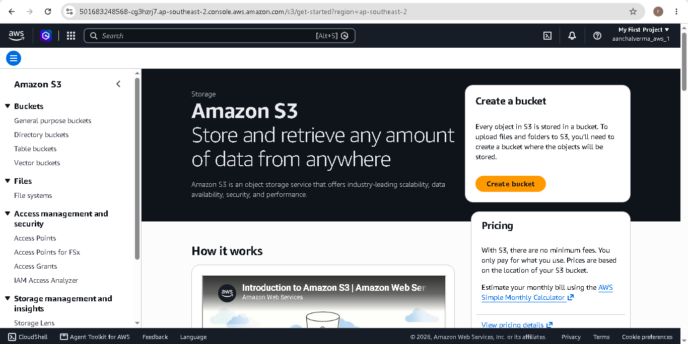
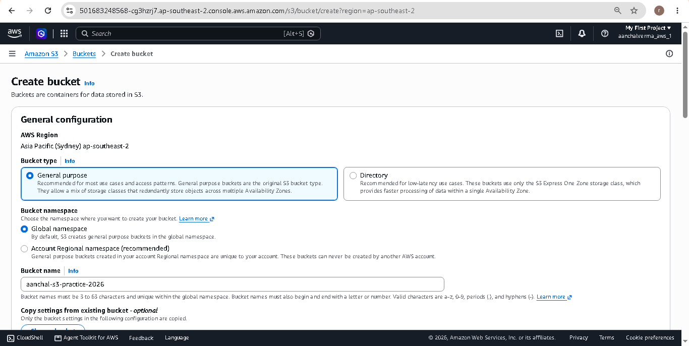
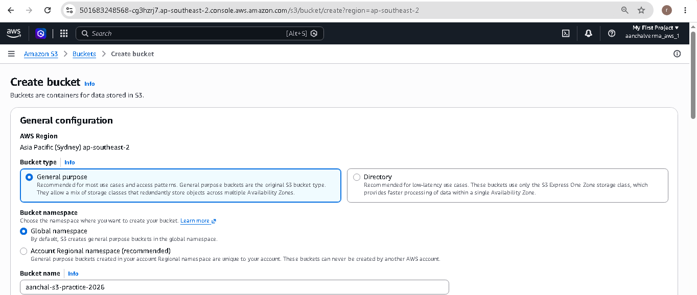
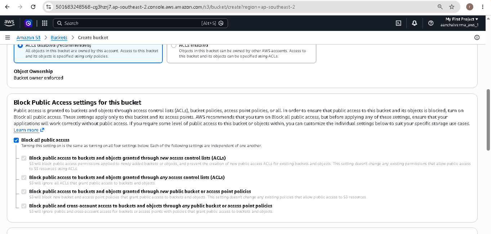
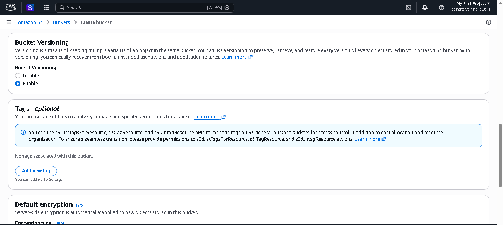
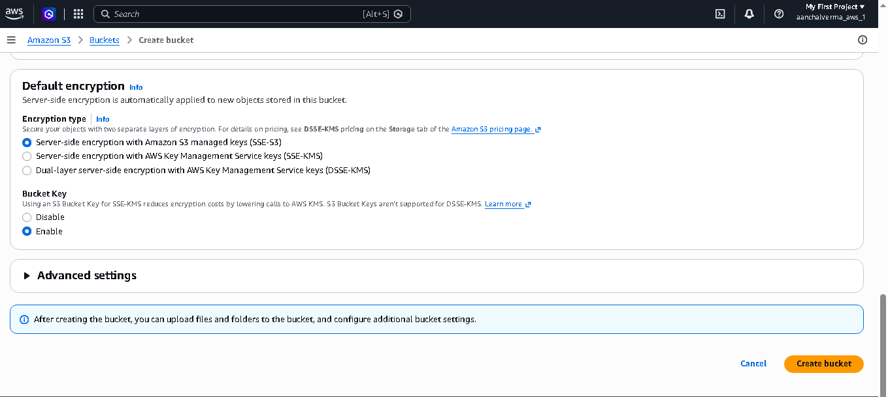
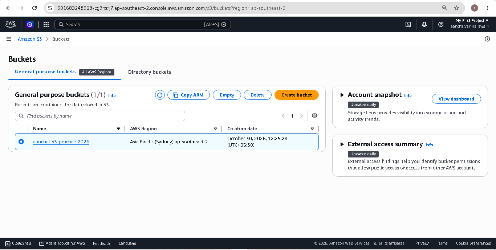

# Lab 02 — Create and Configure an S3 Bucket

## Objective

The objective of this lab is to create an Amazon S3 bucket and configure its basic settings, including versioning, public access protection, and default encryption.

## What is Amazon S3?

Amazon S3 (Simple Storage Service) is an object storage service provided by AWS.

It is used to store and retrieve data such as images, documents, videos, backups, and application files.

## Concepts Learned

### 1. What is an S3 Bucket?

An S3 bucket is a container used to store objects (files) in Amazon S3.

### 2. What is an S3 Object?

An object is any file stored inside an S3 bucket, such as an image, PDF, video, or backup file.

### 3. What is Bucket Versioning?

Bucket Versioning allows us to maintain multiple versions of an object.

If a file is updated or overwritten, S3 can preserve its previous versions.

### 4. What is Block Public Access?

Block Public Access is a security feature that prevents unauthorized public access to S3 buckets and their objects.

### 5. What is Default Encryption?

Default Encryption automatically encrypts new objects when they are uploaded to an S3 bucket.

Amazon S3 supports SSE-S3 encryption using Amazon S3-managed keys.

### 6. What is Object Ownership?

Object Ownership determines who owns the objects in an S3 bucket and how access permissions are managed.

Bucket owner enforced disables ACLs and makes the bucket owner own all objects.

## Practical Implementation

1. Logged in to the AWS Management Console.
2. Opened the Amazon S3 service.
3. Clicked on Create Bucket.
4. Selected the AWS Region.
5. Entered a globally unique bucket name.
6. Kept ACLs disabled (Bucket owner enforced).
7. Enabled Block All Public Access.
8. Enabled Bucket Versioning.
9. Configured Default Encryption using SSE-S3.
10. Successfully created the S3 bucket.

## Bucket Configuration

| Configuration | Value |
|---|---|
| Bucket Type | General Purpose |
| Bucket Name | aanchal-s3-practice-2026 |
| AWS Region | ap-south-1 (Mumbai) |
| Object Ownership | Bucket owner enforced |
| Block Public Access | Enabled |
| Bucket Versioning | Enabled |
| Default Encryption | SSE-S3 |

**Note:** Replace the example bucket name and Region with your actual configuration.

## Screenshots

### 1. Amazon S3 Dashboard

### 2. Create S3 Bucket

### 3. Bucket Name and Region

### 4. Block Public Access

### 5. Versioning Enabled

### 6. Default Encryption

### 7. Successfully Created Bucket

## Key Learnings

- Learned how to create an Amazon S3 bucket.
- Understood S3 bucket naming rules.
- Learned about AWS Regions.
- Understood Block Public Access settings.
- Learned how Bucket Versioning works.
- Understood default encryption using SSE-S3.
- Learned basic S3 security configurations.

## Lab Status

**Completed** — Created and configured an Amazon S3 bucket successfully.

## Conclusion

In this lab, I learned how to create and configure an Amazon S3 bucket using the AWS Management Console. I also explored important S3 security features such as Block Public Access, Bucket Versioning, and Default Encryption.
