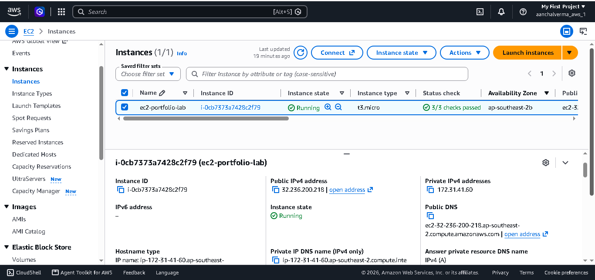
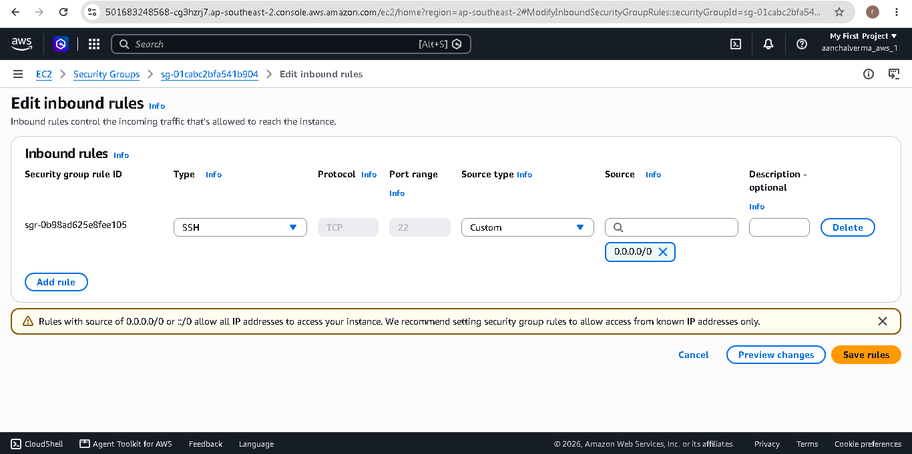
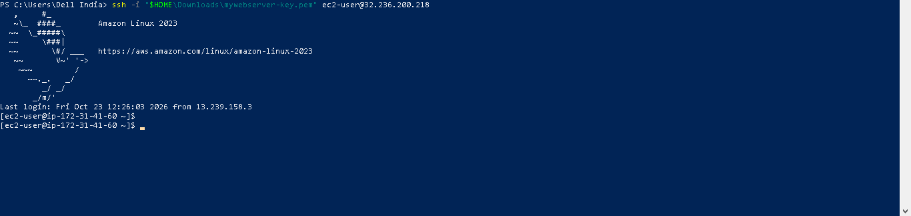
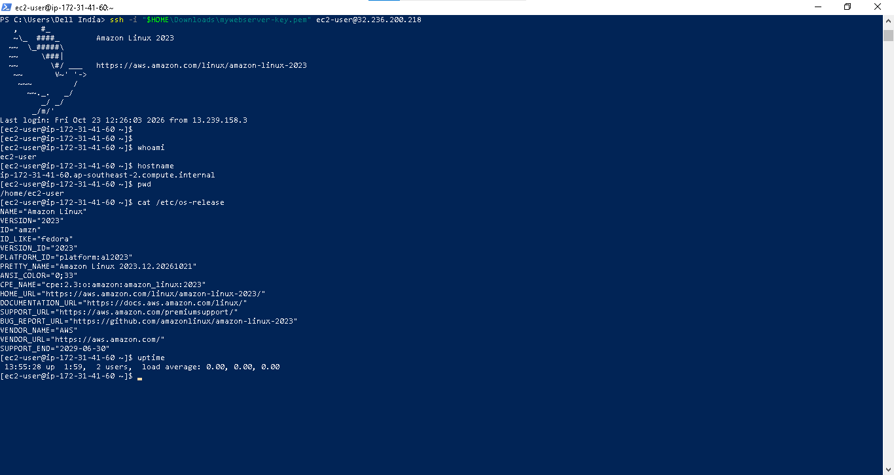

# Lab 02: SSH Connection to AWS EC2

## 1. Objective

The objective of this lab is to securely connect to an Amazon EC2 Linux instance using SSH and verify the remote server using Linux commands.

## 2. AWS Services and Tools

- Amazon EC2
- Amazon VPC
- EC2 Security Groups
- SSH (Secure Shell)
- Windows PowerShell / WSL Ubuntu
- Linux command line

## 3. Prerequisites

- An AWS account
- A running EC2 Linux instance
- A valid EC2 key pair
- A reachable instance with a public IPv4 address, or another configured network access method
- An SSH client
- An SSH Security Group rule restricted to my public IP

## 4. SSH Concepts

SSH is a secure protocol used to access and manage remote systems.

The EC2 key pair consists of:

- Public key: configured for authentication on the instance.
- Private key: kept securely by the user and used to authenticate.

The Security Group controls whether SSH traffic can reach the instance.

## 5. Configuration

- Instance name: ec2-portfolio-lab
- Operating system: [Actual AMI / Linux distribution]
- Region: [Actual AWS Region]
- Instance type: [Actual instance type]
- SSH port: 22/TCP
- SSH username: [Actual Linux username]
- Key pair name: [Actual key pair name; never upload the private key]

## 6. Security Group Configuration

| Setting | Value |
|---|---|
| Type | SSH |
| Protocol | TCP |
| Port | 22 |
| Source | My IP /32 |

SSH access is restricted to my public IP instead of allowing connections from every IP address.

## 7. SSH Connection Command

For an Amazon Linux instance from Windows PowerShell:

```powershell
ssh -i "$HOME\Downloads\devops-lab-key.pem" ec2-user@YOUR_PUBLIC_IP
```

Replace the example key path, username, and IP address with the actual values for your instance.

For an Ubuntu AMI, the default SSH username is generally `ubuntu`.

## 8. Linux Verification Commands

```bash
whoami
hostname
pwd
cat /etc/os-release
uptime
```

These commands verify the login user, hostname, current directory, Linux distribution, and system uptime.

## 9. Screenshots and Evidence

### EC2 Instance Running



### SSH Security Group



### Successful SSH Login



### Linux Command Output



## 10. Troubleshooting

Common SSH issues include:

- Permission denied (publickey): verify the key pair, username, and private key.
- Connection timed out: verify the public IP, network connectivity, and inbound Security Group rule.
- Unprotected private key file: correct private key permissions when using Linux or WSL.

Document only the issues actually encountered and the fixes that were tested.

## 11. Security Best Practices

- Never commit a private key (`.pem`) to GitHub.
- Restrict inbound SSH access to a trusted source IP.
- Never share AWS access keys, passwords, or secret tokens.
- Use the correct Linux username and key pair.
- Review SSH access and remove unnecessary rules.

## 12. Cleanup

- Verify that the Security Group does not have unnecessary inbound rules.
- Stop or terminate temporary EC2 resources when no longer needed.
- Check for unused EBS volumes, snapshots, and other billable resources.
- Review AWS Billing after completing the lab.

## 13. Learning Outcomes

After completing this lab, I learned how SSH authentication works, how to connect to a Linux EC2 instance, how Security Groups control SSH access, and how to verify a remote server using Linux commands.

## 14. Lab Status

Status: [Planned / In Progress / Completed]

Mark this lab as Completed only after successful connection, verification, screenshot upload, and documentation.
