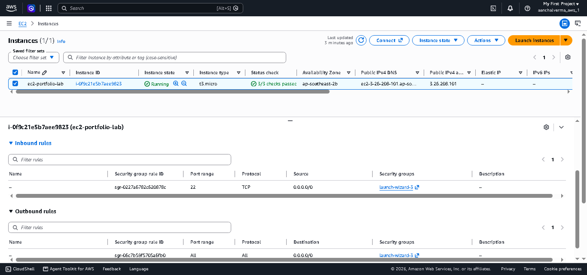
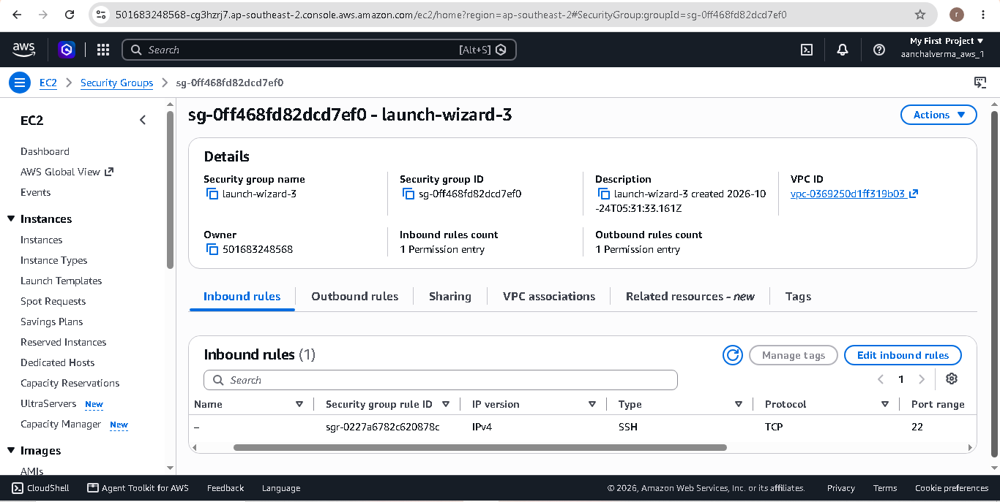
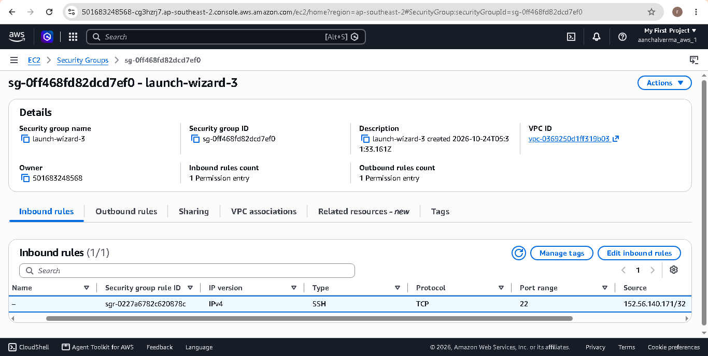
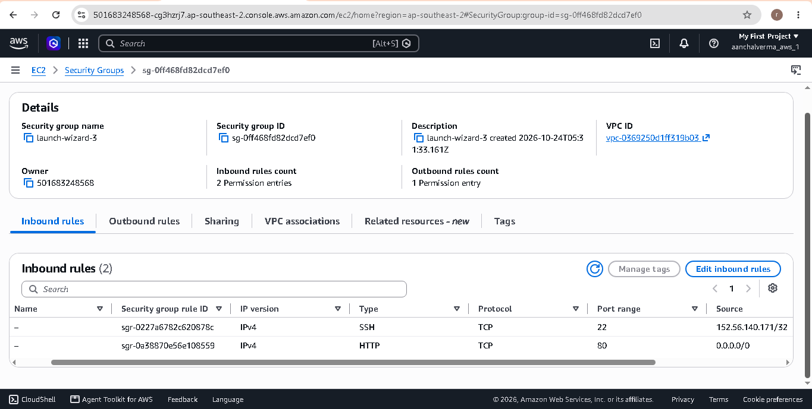

# Lab 03: Configure AWS EC2 Security Groups

## 1. Objective

The objective of this lab is to understand AWS Security Groups and configure inbound traffic rules for an EC2 Linux instance.

## 2. AWS Services Used

- Amazon EC2
- Amazon VPC
- EC2 Security Groups

## 3. What Is a Security Group?

A Security Group acts as a virtual firewall for AWS resources. It controls inbound and outbound network traffic based on configured rules.

Security Groups are stateful, so response traffic for an allowed connection is automatically permitted.

## 4. Lab Environment

- Instance name: ec2-portfolio-lab
- Operating system: [Actual AMI]
- AWS Region: [Actual Region]
- Security Group: [Actual Security Group name]

## 5. Inbound Rules Configuration

| Type | Protocol | Port | Source | Purpose |
|---|---|---|---|---|
| SSH | TCP | 22 | My IP (/32) | Secure remote administration |
| HTTP | TCP | 80 | 0.0.0.0/0, if required | Public website access |

SSH access should be restricted to a trusted source IP. HTTP should be enabled only when a public website is required.

## 6. Steps Performed

1. Opened the EC2 Console.
2. Selected the EC2 instance.
3. Opened the attached Security Group.
4. Reviewed existing inbound rules.
5. Configured or verified SSH access on TCP port 22.
6. Restricted SSH source to my public IP.
7. Added an HTTP rule on TCP port 80 only if required for website hosting.
8. Saved the rules and verified the configuration.

## 7. Screenshots

### EC2 Security Tab

### Inbound Rules Before Configuration

### SSH Port 22 Restricted to My IP

### Final Inbound Rules

## 8. Verification

- [ ] Confirmed the correct Security Group is attached to the instance.
- [ ] Verified the SSH inbound rule uses TCP port 22.
- [ ] Verified SSH source is restricted to my trusted public IP.
- [ ] Added HTTP port 80 only if required.
- [ ] Tested SSH connectivity after saving the rules.
- [ ] Uploaded actual screenshots to GitHub.

## 9. Troubleshooting

### SSH Connection Timed Out

Possible causes:
- SSH inbound rule is missing or has the wrong source IP.
- The instance is not reachable through its network configuration.
- The public IP has changed.
- A network firewall is blocking the connection.

### Permission Denied (publickey)

Possible causes:
- Incorrect private key.
- Incorrect Linux username.
- The private key does not match the instance's configured key pair.

Note: Permission denied errors usually relate to SSH authentication rather than the Security Group rule itself.

## 10. Security Best Practices

- Never expose SSH to 0.0.0.0/0 unless there is a specific, carefully controlled reason.
- Allow only required ports.
- Use the principle of least privilege.
- Remove unused inbound rules.
- Never upload private keys or AWS credentials to GitHub.

## 11. Cleanup

- Remove temporary HTTP rules when no longer required.
- Keep SSH access restricted to a trusted source.
- Review AWS resources and billing after completing the lab.

## 12. Learning Outcomes

This lab helped me understand Security Group inbound rules, TCP ports, SSH access restrictions, HTTP access, and common network troubleshooting scenarios.

## 13. Lab Status

Status: [Planned / In Progress / Completed]

Mark this lab as Completed only after verifying the rules, testing the required connectivity, and uploading actual screenshots.
