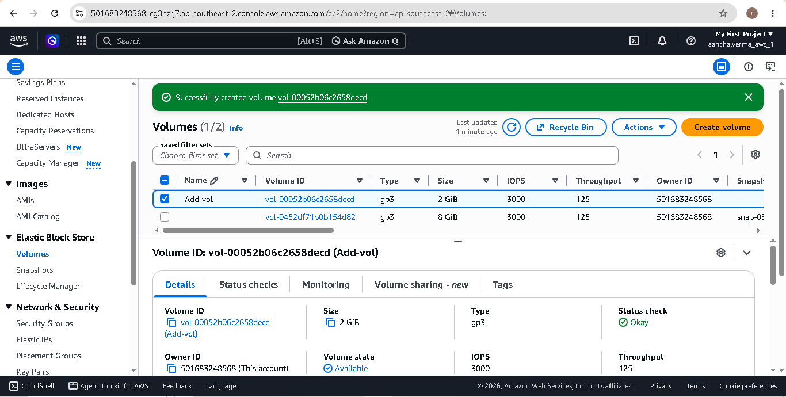
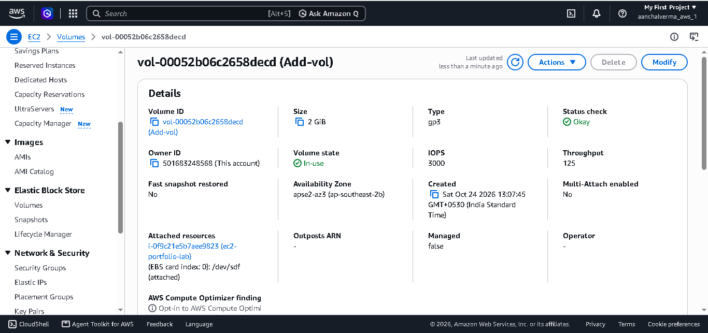
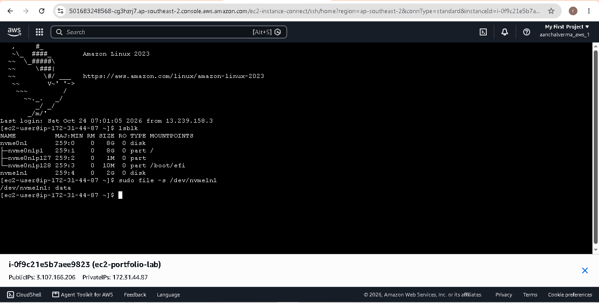
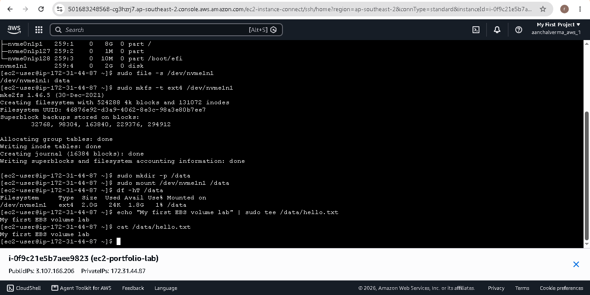

# Lab 05: Create and Mount an EBS Volume

## Objective

The objective of this lab is to create an Amazon EBS volume, attach it to an EC2 instance, format it with the ext4 filesystem, and mount it on a Linux directory.

## AWS Services and Tools Used

- Amazon EC2
- Amazon Elastic Block Store (EBS)
- Amazon Linux
- Linux commands: `lsblk`, `mkfs`, `mount`, `df`, `mkdir`

## What Is Amazon EBS?

Amazon Elastic Block Store (EBS) is a block storage service that provides persistent storage for EC2 instances.

An EBS volume works like an additional hard disk attached to a server.

## Architecture

```text
AWS Cloud
   |
   v
EC2 Linux Instance
   |
   v
Additional EBS Volume (2 GiB)
   |
   v
ext4 Filesystem
   |
   v
/data Mount Point
   |
   v
/data/hello.txt
```

## Practical Steps

### 1. Create an EBS Volume

1. Open the AWS Management Console.
2. Navigate to EC2 → Elastic Block Store → Volumes.
3. Click Create volume.
4. Select `gp3` as the volume type.
5. Set the volume size to `2 GiB`.
6. Select the same Availability Zone as the EC2 instance.
7. Create the volume.



### 2. Attach the Volume to EC2

1. Select the newly created EBS volume.
2. Choose Actions → Attach volume.
3. Select the EC2 instance.
4. Select an available data-volume device name.
5. Attach the volume.



### 3. Identify the New Disk

Connect to the EC2 instance using SSH.

Run:

```bash
lsblk
```

Identify the new disk by comparing its size and mount point with the existing disks.



### 4. Create a Filesystem

After confirming that the selected device is the new, empty EBS volume, create an ext4 filesystem.

Example only; replace the device name with the one verified on your instance.

```bash
sudo mkfs -t ext4 /dev/nvme1n1
```

**Warning:** Formatting the wrong device can destroy data. Never format the root disk or a disk containing important data.

### 5. Create a Mount Point

```bash
sudo mkdir -p /data
```

### 6. Mount the EBS Volume

```bash
sudo mount /dev/nvme1n1 /data
```

### 7. Verify the Mount

```bash
df -hT /data
```

Create and read a test file:

```bash
echo "My first EBS volume lab" | sudo tee /data/hello.txt
cat /data/hello.txt
```

Expected output:

```text
My first EBS volume lab
```



## Important Concepts Learned

- Creating an EBS volume.
- Understanding Availability Zone requirements.
- Attaching an EBS volume to an EC2 instance.
- Identifying block devices using `lsblk`.
- Creating an ext4 filesystem.
- Mounting a filesystem on `/data`.
- Verifying storage using `df -hT`.

## Cost Awareness

EBS storage may incur charges based on provisioned capacity, volume type, and applicable free-tier or credit allowances.

Check AWS Billing and Free Tier usage before and after the lab. Delete the practice volume only after confirming that it contains no data you need.

## Lab Status

- [ ] EBS volume created
- [ ] Volume attached to EC2
- [ ] New disk identified using `lsblk`
- [ ] Filesystem created
- [ ] Volume mounted at `/data`
- [ ] Test file created and verified
- [ ] Screenshots uploaded to GitHub

## References

- [Create an EBS Volume](https://docs.aws.amazon.com/ebs/latest/userguide/ebs-creating-volume.html)
- [Attach an EBS Volume](https://docs.aws.amazon.com/ebs/latest/userguide/ebs-attaching-volume.html)
- [Make an EBS Volume Available for Use](https://docs.aws.amazon.com/ebs/latest/userguide/ebs-using-volumes.html)
- [Amazon EBS Pricing](https://aws.amazon.com/ebs/pricing/)
